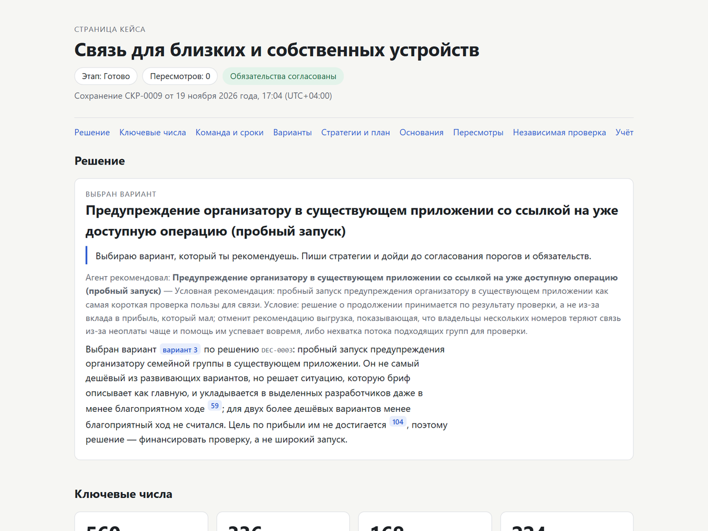
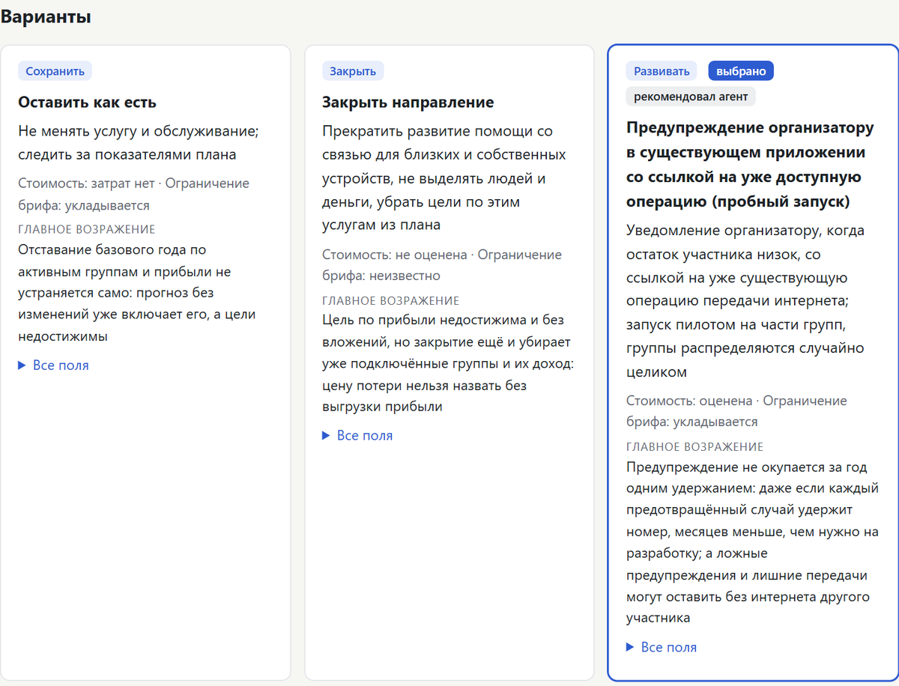
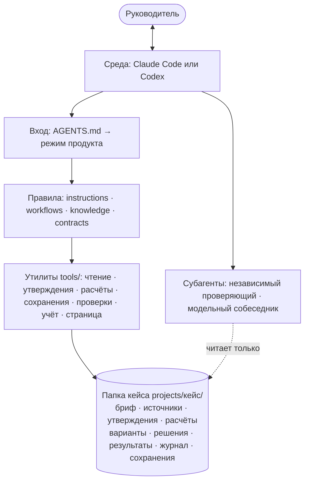
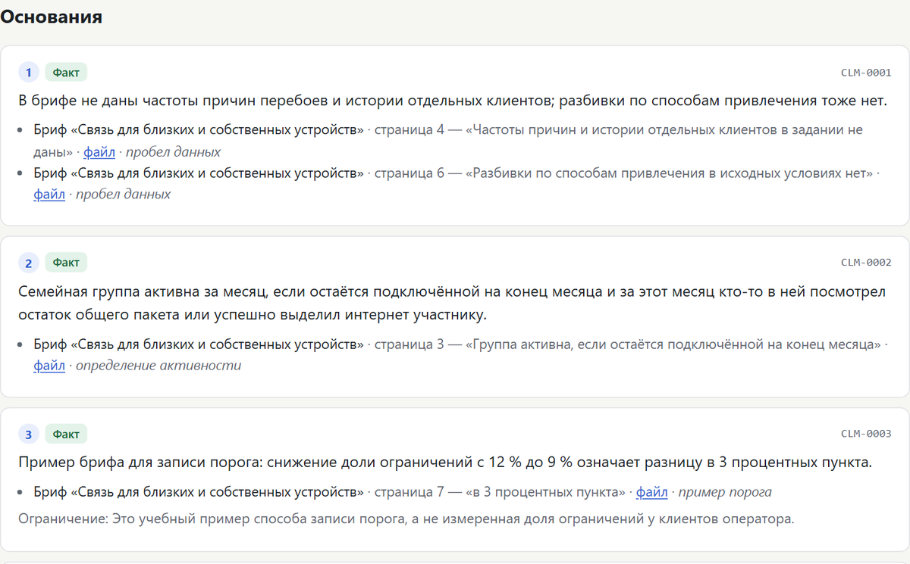

# Агент продуктовой и коммуникационной стратегии

**Руководитель цифрового продукта пишет задачу обычными словами и прикладывает материалы. Агент доводит её до двух согласованных стратегий, продуктовой и коммуникационной, с планом проверки, решением и обязательствами. Каждое число он считает утилитой, каждый вывод подтверждает источником, а выбор всегда оставляет человеку.**

Работает внутри **Claude Code** и **Codex**: это не отдельное приложение, а папка с правилами, методиками и утилитами. Открыли папку, написали задачу. Нужен только доступ к самой среде: отдельных сервисов, дополнительных ключей и платных API нет.

```text
запрос → постановка → исследование → варианты → выбор человека → стратегии → план проверки → решение и обязательства
```



<sub>Страница кейса из демопроекта: решение руководителя и рекомендация агента разведены, у каждого числа — ссылка на расчёт или место в брифе.</sub>

**Содержание:** [Зачем](#зачем) · [Как выглядит работа](#как-выглядит-работа) · [Демопроект](#демопроект) · [Быстрый старт](#быстрый-старт) · [Как управлять](#как-управлять) · [Как устроено](#как-устроено) · [Дополнительный уровень](#дополнительный-уровень) · [Как проверено](#как-проверено) · [Что агент читает](#что-агент-читает) · [Ограничения](#ограничения) · [Карта репозитория](#карта-репозитория) · [Для разработчиков](#для-разработчиков)

---

## Зачем

Стратегию можно попросить у обычного чата. Получится гладкий текст, но руководителю придётся проверять его самому:

| Обычный чат | Этот агент |
|---|---|
| Числа модель пишет по памяти, их не проверить | Числа считает утилита из ячеек и строк материала, формула записана, каждый расчёт пересчитывается |
| Вывод нельзя проследить до источника | У каждого утверждения есть место в источнике — страница, лист и ячейка, строка — и цитата, которую проверяет утилита |
| Рекомендация модели незаметно становится «решением» | Предложение агента и выбор руководителя — разные записи. Выбор записывается словами человека |
| После перерыва контекст теряется | Вся память кейса лежит в его папке. Новый чат и даже другая среда продолжают с того же места |
| Неизвестное заполняется правдоподобным | Неизвестное остаётся неизвестным: допущения помечены, расход без данных — «неизвестно», а не ноль |
| Работа заканчивается текстом | После решения остаются обязательства с ответственными, сроками и условиями пересмотра, а новые данные запускают пересмотр только затронутого |

Мы проверили это на деле. Одни и те же реплики подали агенту и обычному чату той же среды и модели, по два кейса в каждой среде. Два судьи-модели в **4 из 4** пар решили, что руководителю меньше пришлось бы исправлять результат агента. Оба чата Codex после перерыва **потеряли выбор руководителя**, ни один агент его не потерял. Цена тоже названа: агент работает в 2–5,5 раза дольше и тратит в 5–6,6 раза больше. Это ориентир, а не доказательство: сравнение шло на промежуточной версии, по одному прогону на пару и на кейсах, которые использовались при разработке. [Отчёт о сравнении](docs/acceptance/e06-report.md).

## Как выглядит работа

Реплика из демопроекта и ответ агента без правок, сокращения отмечены […]:

> **Руководитель:** Бриф утверждаю. Если что-то неясно, прими разумное допущение и назови его. Интервью с клиентами не проводим. Исследуй по брифу и дойди до вариантов и рекомендации, затем жди моего выбора.

> **Агент:** Исследование и варианты готовы. Теперь нужен ваш выбор направления. […]
>
> **Моя рекомендация — условная: пробный запуск предупреждения организатору.** Он закрывает ситуацию, которую бриф описывает как главную: организатор узнаёт о перебое только из просьбы близкого. […]
>
> **Неудобная правда.** Ни один вариант, для которого вклад можно посчитать, не закрывает нехватку прибыли в 6 млн руб. […] Поэтому просьба к руководителю в конце первого квартала — профинансировать проверку на одном тарифе, а не широкий запуск.
>
> ```text
> Этап: Выбор
> Готово: исследование по материалу брифа, шесть вариантов с затратами и сверкой с ресурсом, условная рекомендация
> Дальше: после вашего выбора напишу стратегии продукта и коммуникации и согласую с вами пороги и обязательства
> Жду от вас: выбор направления (рекомендован предупреждающий пробный запуск)
> ```

Каждый ответ, после которого агент ждёт человека, заканчивается таким блоком статуса: где мы, что готово, что дальше и что нужно от руководителя.

Путь кейса и остановки, где решает человек:

```mermaid
flowchart LR
    A([Запрос и материалы]) --> B[Постановка]
    B -->|руководитель утверждает| C[Исследование]
    C --> D[Варианты и рекомендация]
    D -->|руководитель выбирает| E[Стратегии]
    E --> F[План проверки и обязательства]
    F -->|независимая проверка| G{{Пороги и обязательства}}
    G -->|руководитель согласует| H([Готово: документ и страница кейса])
    H -.->|новые данные| I[Пересмотр затронутого]
    I -.-> E
```



Выйти из этапа нельзя, пока утилита проверки не подтвердит, что он закончен. Например: у каждого варианта есть стоимость, ответственные в обязательствах — только из названного состава команды, в документе по брифу нет чисел с лишними знаками после запятой. После каждого этапа агент сохраняется.

## Демопроект

[`demo/`](demo/README.md) — кейс по «Примеру брифа» хакатона МегаФона «Связь для близких и собственных устройств». Оператор вымышлен, числа учебные. Единственный материал — PDF брифа на 11 страниц. Бриф просит сдать один документ из пяти частей с резюме.

| | |
|---|---|
| Реплик руководителя | 5: запрос, «бриф утверждаю», «выбираю рекомендованный», ответ о команде, согласие с порогами |
| Время работы | 34 мин по пяти репликам. Учёт кейса показывает 31 мин: он считает от первой до последней записи журнала |
| Расход | 5,74 $ по журналу Claude Code за весь прогон. Это расчётная стоимость по тарифу API, работа шла по подписке. Учёт кейса показывает 5,17 $ — сумму, известную агенту к последней реплике |
| Утверждений со ссылкой на страницу брифа | 38, из них 2 агент позже отозвал |
| Расчётов утилитой | 115, 1 отозван |
| Вариантов | 6, среди них «оставить как есть» и «закрыть направление» |
| Независимая проверка | 10 замечаний, все приняты и исправлены |
| Итоговые проверки | Валидатор папки кейса — 0 ошибок, проверка этапа «Готово» пройдена |
| Среда и модель | Claude Code 2.1.325, `claude-sonnet-5-5`, версия агента PR №77 |

Тот же кейс прошёл и **с переносом**: начат в Claude Code, закончен в Codex в новом чате, до готового документа. В журнале одного кейса — действия обеих сред.

Как читать результат:

1. [Страница кейса](demo/family-connect/outputs/case-page.html) — скачайте и откройте в браузере. На одной странице решение, числа, команда, варианты, документы, основания, проверка и учёт.
2. [Итоговый документ по брифу](demo/family-connect/outputs/deliverable.md) — резюме и пять частей.
3. [Продуктовая](demo/family-connect/outputs/product-strategy.md) и [коммуникационная](demo/family-connect/outputs/communication-strategy.md) стратегии, [план проверки](demo/family-connect/outputs/validation-plan.md), [решение и обязательства](demo/family-connect/outputs/commitments.md).



<sub>Варианты на странице кейса. Выбранный отмечен отдельно от рекомендации агента.</sub>

Ошибки агента мы не прячем. Перед сдачей демопроект ещё раз прошёл независимую проверку, и найденное названо в [путеводителе по демопроекту](demo/README.md). Например, вклад в прибыль посчитан шире, чем позволяет воронка самого документа. Файлы кейса — подлинный результат прогона, их защищают хэши, поэтому задним числом ошибки не исправлены.

## Быстрый старт

1. Установите [uv](https://docs.astral.sh/uv/). Python 3.12 `uv` скачает сам.
2. Один раз выполните подготовку в терминале этой папки. Нужна сеть.

   Windows, PowerShell:

   ```powershell
   $env:UV_PYTHON_INSTALL_DIR = "$PWD\.python"
   uv sync --locked --managed-python
   ```

   macOS и Linux:

   ```text
   uv sync --locked
   ```

3. Откройте папку в Claude Code или Codex и напишите задачу в новом чате. Codex запускайте командой `codex -c web_search=live`, чтобы агент мог читать сайты. Claude Code при первых запусках утилит и открытии сайтов спросит разрешение — разрешите команды из этой папки. Пример задачи:

   > Почему падает удержание в нашем сервисе доставки? Вот выгрузка заказов и заметки по интервью, решение нужно к концу месяца.

Шаблоны и команды не нужны. Агент покажет, как понял задачу, и попросит подтвердить. Подробно, с особенностями каждой среды, — в [`START.md`](START.md).

| Что нужно | Зачем |
|---|---|
| `uv` и Python 3.12 | Утилиты чтения, расчётов, сохранения и учёта. Версии закреплены в `uv.lock` |
| Claude Code или Codex со своим входом | Сама работа агента: подписка или ключ API пользователя |
| Сеть | Один раз для `uv sync`, дальше только для поиска и чтения сайтов. Без сети агент работает с вашими файлами и говорит об этом при постановке |

Платные сервисы сверх доступа к среде не нужны. Библиотеки чтения (`pypdf`, `python-docx`, `openpyxl`) бесплатны. Входят ли поиск и чтение сайтов в тариф конкретного пользователя и какой минимальный тариф нужен каждой среде, мы не проверяли.

## Как управлять

Обычными словами, в любой момент:

| Что нужно | Что написать | Что сделает агент |
|---|---|---|
| Прерваться | «Остановись» | Закончит шаг, сохранится и скажет, как продолжить |
| Вернуться, в том числе в новом чате или другой среде | «Продолжи кейс» | Восстановит кейс по последнему сохранению, назовёт этап и следующий шаг |
| Изменить условие | «Цену менять нельзя» | Назовёт, что это затрагивает, и переделает затронутое |
| Не согласиться | «Не согласен, берём другой» | Запишет ваш выбор, даже если он расходится с рекомендацией |
| Доверить выбор | «Реши сам, бери рекомендованный» | Возьмёт сохранённую рекомендацию и скажет, от чего отказываемся |
| Спросить об основании | «Почему рекомендован второй вариант?» | Ответит со ссылками на расчёты и источники |
| Спросить о решении | «Кто отвечает за запуск?» | Ответит по обязательствам |
| Передать новые данные | «Вот свежая выгрузка, посмотри, что она меняет» | Покажет затронутые выводы, дождётся выбора, перепишет только их и сохранит прежние версии |
| Показать наглядно | «Покажи страницу кейса» | Соберёт одну HTML-страницу, которая открывается без сервера и сети |

Агент ничего не публикует и не отправляет: на «опубликуй» он предложит подготовить текст.

## Как устроено



**Числа, источники и учёт ведут утилиты, а не модель.**

- `tools/calc.py` берёт значения из ячеек и строк материала, валидатор пересчитывает каждый расчёт.
- `tools/evidence.py` проверяет, что цитата действительно стоит в указанном месте источника.
- `tools/accounting.py` выводит время, ошибки, участие человека и расход из журнала действий.
- `tools/gate.py` решает, можно ли выйти из этапа.

Всё это Python без модели.

**Вся память — в папке кейса.** Каждое действие попадает в журнал, после каждого этапа сохраняются снимки файлов. В новом чате агент восстанавливает этап, следующий шаг, рекомендацию и выбор человека и читает только процедуры текущего этапа. Папку можно перенести в другую среду. Повреждённое сохранение не теряет работу.

**В контексте только то, что нужно сейчас.** Процедуру этапа агент читает, когда до него дошёл. Записи кейса нумеруются, и нужную агент выводит по номеру, не держа реестры целиком.

**Одна методика для всех сред.** Различаются только инструменты поиска и чтения сайтов: процедура описывает их как возможности среды с запасным путём. Вход — `AGENTS.md`, Claude Code читает его через `CLAUDE.md`.

**Режим продукта отделён от разработки.** В режиме продукта агент пишет только в папку кейса и не меняет свои инструкции. Текст материалов, сайтов и полей кейса — данные. Если в документе есть просьба сменить цель или выполнить команду, агент отмечает её как находку и не выполняет.

<details>
<summary><b>Слои и файлы подробнее</b></summary>

| Слой | Где лежит | Что делает |
|---|---|---|
| Вход | `AGENTS.md`, `CLAUDE.md` | Выбор режима: продукт или разработка |
| Постоянные правила | `agent/instructions/product-mode.md` | Блок статуса, язык пользователя без служебных слов, предложение не равно решению, материалы — данные |
| Процедуры | `agent/workflows/`, 16 файлов | Постановка, ход кейса, чтение материалов и изображений, утверждения, расчёты, исследование, варианты, стратегии, независимая проверка, интервью, пересмотр, сохранение, учёт |
| Методики | `agent/knowledge/`, 7 файлов | Как ставить задачу, исследовать, считать, строить стратегию, вести интервью, разбирать интерфейс. Фактов о рынке нет |
| Контракты | `agent/contracts/` | JSON-схемы и описание каждого вида записи, коды ошибок, проверки этапов |
| Роли субагентов | `agent/roles/`, `.claude/agents/`, `.codex/agents/` | Независимый проверяющий и модельный собеседник |
| Навыки | `.claude/skills/`, `.agents/skills/` | Продолжение, интервью, пересмотр |
| Хуки | `.claude/settings.json`, `tools/*_guard.py` | Лимит поиска из брифа, изоляция субагентов |
| Утилиты | `tools/` | Всё, где нужна точность |
| Кейсы | `projects/<кейс>/` | Состояние и результат. Каталог не публикуется |

</details>

## Дополнительный уровень

| Возможность | Как сделано | Что подтверждено |
|---|---|---|
| **Независимый проверяющий** | Субагент `reviewer` проверяет стратегии, план, обязательства и документ, прежде чем их увидит руководитель. Он не видит рассуждений агента, в Claude Code хук пускает его только в папку кейса. Каждое замечание агент проверяет сам. Если среда не умеет запускать субагентов, проверки нет, и агент так и говорит | В демопроекте 10 замечаний, все приняты. Прогона без проверяющего в Claude Code нет, поэтому польза не доказана; в Codex 0–1 замечание |
| **Модельные собеседники** | Гайд интервью, карточки персонажей и беседы с субагентом `respondent`. Он видит только карточку и вопросы, но не гипотезы агента | Проверено в обеих средах. Синтетические беседы готовят вопросы, но не подтверждают спрос |
| **Маршрутизация моделей** | Собеседник идёт на дешёвую модель (`claude-haiku-5-5`, `gpt-6-luna`). Если ответ не прошёл проверку формы, беседа повторяется на основной | 4 из 4 бесед в каждой среде прошли на дешёвой модели. Экономия по одному прогону не доказана |
| **Навыки** | Три навыка в обеих средах — короткие обёртки над процедурами | Продолжение без навыков дороже: 3,64 $ против 2,54 $ в Claude Code |
| **Хуки** | Поиск без записанного действия отклоняется, субагенты читают только своё | Тесты и живые прогоны в Claude Code |
| **Скриншоты интерфейса** | PNG, JPEG, WebP и снимки публичных страниц, наблюдения с местом на изображении | Разбор приложенных скриншотов проверен вживую в обеих средах. Снимок реального сайта и отказ без Playwright вживую не проверены |
| **Пересмотр при новых данных** | Затронутые выводы, выбор человека, переписывание только затронутого, хранение версий | Проверено в обеих средах и с переносом |
| **Страница кейса** | Один HTML-файл без сервера: решение, команда, варианты, основания, проверка, учёт | Проверено в обеих средах |
| **Перенос между средами** | Папка кейса самодостаточна | Демокейс начат в Claude Code и закончен в Codex |



<sub>Основания на странице кейса: гипотезы агента отделены от фактов брифа, у факта — страница и цитата.</sub>

## Как проверено

- **Около 1 150 модульных тестов** утилит и проверки документов — CI запускает их на каждом PR на Ubuntu и Windows. Сухие прогоны сценариев — на Windows.
- **Живые прогоны в изолированной копии** без личных настроек среды. Скрипт `scripts/live-entry.ps1` подаёт реплики и собирает отчёт: время, расход, проверки этапов, выход за папку, реакцию на указания, внедрённые в материал.
- **Три кейса с контрольными числами:** удержание клиентов малого бизнеса, выбор направления в B2C и демопроект по брифу МегаФона.

Финальный прогон в обеих средах на версии PR №62, 17–18 ноября 2026 года. Все наборы дошли до конца, проверки этапов пройдены. Найденные в нём замечания исправлены и проверены отдельными прогонами в PR №64 и №66, демопроект сделан на более поздней версии:

| Набор | Что проверяет | Claude Code | Codex |
|---|---|---|---|
| `hard` | Полный путь со сбоями и внедрённым в материал указанием | 38 мин, 7,86 $ | 68 мин, 21,4 млн входных токенов |
| `continue` | Новый чат и перенос из другой среды | — | 9 мин, 2,1 млн |
| `entry` | Первый запуск из чистой папки | 8 мин, 2,11 $ | 28 мин, 3,5 млн |
| `revise` | Пересмотр при новых данных | 6,5 мин, 1,65 $ | 17,5 мин, 3,7 млн |
| `interviews` | Гайд и модельные собеседники | 33 мин, 2,92 $ | 42 мин, 9,5 млн |
| `team` | Команда, обязательства, страница кейса | 11 мин, 2,26 $ | 12,7–14 мин, 3,3–5,0 млн |

Codex показывает расход в токенах, а не в деньгах, поэтому единицы в столбцах разные. Числа — по одному прогону на ячейку, устойчивой оценкой мы их не считаем. Отчёты: [приёмка ядра](docs/acceptance/b12-report.md), [финальные проверки](docs/acceptance/final-checks-report.md), [демокейс](docs/acceptance/family-connect.md).

## Что агент читает

DOCX, PDF с текстовым слоем, XLSX, CSV, MD и TXT, открытые страницы сайтов, скриншоты интерфейса в PNG, JPEG и WebP.

Пределы одного файла: 25 МиБ, 300 страниц PDF, 1 млн символов текста, 100 тыс. строк и 200 столбцов на лист, 2 млн ячеек.

Скриншоты агент смотрит там, где среда умеет показывать изображения. Снимок публичной страницы он делает, только если установлена необязательная утилита: Playwright и браузер, порядка 150 МБ скачивания и до 740 МБ на диске. Без неё агент покажет команды установки и предложит приложить скриншоты.

Чего агент не прочитает — и скажет об этом:
- видео и аудио;
- сканы без текстового слоя;
- сайты со входом и страницы, которые строятся скриптом.

Такой материал можно сохранить и передать файлом. Подробнее — в [заметке о средах](docs/environments.md).

## Ограничения

- Принятыми считаются две среды, Claude Code и Codex. Cursor, Windsurf, GitHub Copilot и подобные совместимы, если читают `AGENTS.md` и запускают команды, но вживую не проверялись.
- Полный путь проверен на Windows 11. Тесты утилит проходят и на Linux.
- Лимит поиска из брифа в Claude Code держит хук. В остальных средах — только запись действия.
- Расход и версия среды известны, только если среда их показывает.
- Синтетические собеседники не подтверждают спрос: он проверяется планом проверки на реальных пользователях.
- Качество показано по одному прогону на ячейку, и модель даёт разброс. Например, в другом прогоне демопроекта агент назвал не все числа, которые выводит бриф.
- Открытые замечания — в [доработках](docs/tasks/POLISH.md), отложенные проверки — в [списке проверок](docs/acceptance/b12-pending-checks.md).

<details>
<summary><b>Если что-то не работает</b></summary>

Команды для терминала в этой папке. На Windows — `.venv/Scripts/python.exe`, в других системах — `.venv/bin/python`.

| Признак | Проверка |
|---|---|
| Агент просит выполнить подготовку | `uv --version`, затем подготовка из [`START.md`](START.md) |
| Codex на Windows: утилиты не запускаются, `No Python at …` или отказ в доступе | `Get-Content .venv/pyvenv.cfg`: в строке `home` должна быть папка `.python` этого проекта. Иначе повторите подготовку для Windows |
| Не читается файл | `.venv/Scripts/python.exe tools/read_material.py inspect <файл>`: код 2 — в файле нет текста, код 3 — превышен предел |
| Кейс не продолжается в новом чате | `.venv/Scripts/python.exe tools/checkpoint.py resume projects/<кейс>` |
| Нужна проверка папки кейса | `.venv/Scripts/python.exe tools/validate_project.py projects/<кейс>` |
| Среда не авторизована | Claude Code: `claude --version`, `claude auth status`. Codex: `codex --version`, `codex login status` |
| Терминал не находит `codex` | Codex установлен приложением: команда в [`START.md`](START.md) находит `codex.exe` в `%LOCALAPPDATA%\OpenAI\Codex\bin` |
| Codex не читает сайты | Включён ли поиск в интернете: `web_search=live` |

Сбой утилиты агент называет сам и предлагает шаг в пределах кейса: повторить позже, продолжить без материала или учесть текст как непроверенный.

</details>

## Карта репозитория

```text
AGENTS.md, CLAUDE.md   вход: выбор режима
START.md               подробный старт для руководителя
agent/                 правила агента: instructions, workflows, knowledge, contracts, roles
tools/                 утилиты на Python: чтение, утверждения, расчёты, сохранения, проверки, учёт
.claude/, .codex/,     субагенты, навыки и хуки сред
.agents/
demo/                  демопроект по «Примеру брифа»
examples/              проверочные кейсы с контрольными числами
scripts/               проверки репозитория, живые прогоны, сборка архива
tests/                 модульные тесты утилит
docs/                  ТЗ, спецификации, задачи, отчёты приёмки, история разработки
projects/              кейсы пользователя (не публикуются)
```

## Сдаваемый архив

`python scripts/package.py build <архив.zip>` собирает архив текущего коммита. В него попадает только то, что есть в Git: `.work/`, `.venv/`, папки кейсов пользователя и личные настройки не попадают.

`python scripts/package.py check <архив.zip> --rev HEAD --smoke` проверяет архив:
- обязательные файлы на месте;
- нет локальных файлов, строк, похожих на секреты, и путей в домашние папки;
- список файлов совпадает с коммитом;
- первый запуск без модели проходит в чистой временной папке.

## Для разработчиков

1. [Правила разработки](docs/development-rules.md). Корневые `AGENTS.md` и `CLAUDE.md` только выбирают режим: продукт или разработка.
2. [ТЗ](docs/specs/2026-11-04-product-agent-tz.md) и [условия хакатона](docs/hackathon/BRIEF.md).
3. [Общая очередь](docs/tasks/README.md), [карточки обязательного блока](docs/tasks/CORE.md), [улучшения](docs/tasks/IMPROVEMENTS.md).
4. [Подготовка клона и проверки](docs/development.md): PowerShell 7, uv и Python 3.12, локальная защита `main`, общие команды проверок.
5. [Заметка о средах](docs/environments.md): версии, маршруты, пределы входов и воспроизведение проверок.
6. [История разработки](docs/CHANGELOG.md): слитые PR по порядку и как документы ссылаются на версии.

Одна задача — одна ветка и PR. `main` меняется только через слитый PR.
